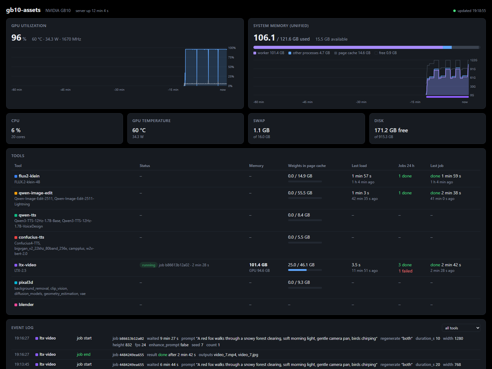

# gb10-assets

Self-hosted generative asset pipeline (image, 3D, video, speech, music) for NVIDIA DGX Spark, ASUS Ascent GX10
and other GB10 systems.

## Description

A GB10 system generates images, videos, 3D assets for games and more, triggered remotely from a client machine.

1. **Server (GB10):** clone this repo, build the Docker image, start the container.
2. **Server (GB10):** install the tools you want to use (their Python environment and model weights).
3. **Client (your workstation):** install the client, submit jobs and receive the generated assets.

Clients talk to the server via REST API, MCP or the Claude Code plugin (skills). The models are chosen mainly
for their free licenses.


The server's [dashboard](#dashboard) shows GPU, memory and tool state and an event log of the jobs:



## Models

| Tool | Model | Task | License | Weights | Client |
|---|---|---|---|---|---|
| `flux2-klein` | [FLUX.2 \[klein\] 4B](https://huggingface.co/black-forest-labs/FLUX.2-klein-4B) | text to image, optional reference images | Apache-2.0 | ~16 GB | `gb10-assets image` |
| `qwen-image-edit` | [Qwen-Image-Edit-2511](https://huggingface.co/Qwen/Qwen-Image-Edit-2511) with the 4-step [Lightning LoRA](https://huggingface.co/lightx2v/Qwen-Image-Edit-2511-Lightning) | edit 1-3 images with an instruction | Apache-2.0 | ~59 GB | `gb10-assets edit` |
| `qwen-tts` | [Qwen3-TTS 1.7B VoiceDesign](https://huggingface.co/Qwen/Qwen3-TTS-12Hz-1.7B-VoiceDesign) and [Base](https://huggingface.co/Qwen/Qwen3-TTS-12Hz-1.7B-Base) | speech with a voice designed from a description or cloned from a recording; de, en, es, fr, it, ja, ko, pt, ru, zh | Apache-2.0 | ~9 GB | `gb10-assets voice`, `speak` |
| `confucius-tts` | [Confucius4-TTS](https://huggingface.co/netease-youdao/Confucius4-TTS) | cross-lingual voice cloning (e.g. a German voice speaking Thai); 14 languages incl. th, vi, id, ms | Apache-2.0 | ~6 GB | `gb10-assets speak-multilingual` |
| `ltx-video` | [LTX-2.5](https://huggingface.co/Lightricks/LTX-2.5) 22B distilled, NVFP4 | video with sound from text or keyframe images, video for an audio track, retake of a time range | [LTX-2.x Community](https://github.com/Lightricks/LTX-2/blob/main/LICENSE-2_x)¹ | ~50 GB | `gb10-assets video`, `audio-to-video`, `retake` |
| `pixal3d` | [Pixal3D](https://huggingface.co/Comfy-Org/Pixal3D) (on TRELLIS.2), run by [ComfyUI](https://github.com/Comfy-Org/ComfyUI) | one image to a textured 3D model: GLB with PBR maps (base color, metallic, roughness, normal, occlusion) | MIT² | ~9 GB | `gb10-assets 3d` |
| `blender` | [Blender](https://www.blender.org) 5.2 as a Python module (bpy), Cycles and EEVEE on the GPU | Python scripts on 3D models: bundled ones for rigging and animating figures, texture and eye fixes, previews and videos of talking figures, or own code | GPL-3.0³ | none (1.9 GB installed) | `gb10-assets blender` |

¹ Not an open-source license: free, also commercially, for companies under $10M annual revenue; the model is
gated, so downloading it needs `HF_TOKEN` and the license accepted on its Hugging Face page.

² Pixal3D, TRELLIS.2, BiRefNet and MoGe are MIT; the DINOv3 image encoder it uses is under Meta's
[DINOv3 License](https://huggingface.co/facebook/dinov3-vitl16-pretrain-lvd1689m). ComfyUI (GPL-3.0) is
downloaded at installation and runs as a separate process; its native 3D nodes need none of the
non-commercial NVIDIA libraries (nvdiffrast, nvdiffrec) of the original TRELLIS.2 code.

³ There is no bpy for Linux ARM64 on PyPI: the first installation builds Blender from source (about 15 minutes
and 10 GB of temporary space; later installations reuse the built wheel). It runs in its own worker process.
Jobs of this tool may run their own Python code, see [Blender code](#blender-code).

The server keeps one model in memory at a time and switches when a job for another tool arrives.

**Video length:** `ltx-video` needs about 51 GB plus memory that grows with width x height x frames, so the
size limits the length (measured on a GB10 with 128 GB): 1536x1024 6 s, 1280x832 9 s, 1024x704 13 s, 1024x576
16 s, 768x512 20 s at 24 fps. Without a size the server picks one that fits; an explicit size with a too long
duration is rejected at submission.

## Server installation (GB10)

### Prerequisites

Docker with the Compose plugin and the NVIDIA Container Toolkit (both preinstalled on DGX OS). The image is
built for `linux/arm64` with CUDA 13 and contains the server and the tool definitions (about 1.2 GB). The tools
themselves, each with its own Python environment and model weights, are installed one by one into a host
directory that is mounted into the container (see [Tools](#tools)).

### Steps

```sh
# 1. clone the repo
git clone https://github.com/StefanMenne/gb10-assets.git && cd gb10-assets

# 2. create the configuration .env (with a random token) and the installed/ and jobs/ directories
scripts/docker.sh init                  # or without authentication: scripts/docker.sh init_without_token

# 3. build the image (about a minute)
scripts/docker.sh build

# 4. start the server (port 8750, restarts automatically after a reboot)
scripts/docker.sh up

# 5. install the first tool: FLUX.2 [klein], about 21 GB with its environment; --all installs every tool
#    (about 160 GB, ltx-video needs HF_TOKEN in .env, see Tools)
scripts/docker.sh install flux2-klein
```

Then check from any machine in the network:

```sh
curl http://<gb10-host>:8750/health
# {"status":"ok","api_version":1,"version":"0.1.0","running":null,"queued":0,"worker":null}
```

### Dashboard

`http://<gb10-host>:8750/dashboard` in any browser shows what the GB10 is doing, refreshed every 2 seconds:

- **System:** GPU utilization, temperature, power and clock (NVML), unified memory split into the worker, other
  processes, page cache and free memory, CPU, swap and disk space, as charts over the last hour. A band under the
  memory chart shows which tool's weights were loaded when.
- **Tools:** one row per tool with its state (running, loading, loaded, queued), the memory of its worker
  (process and GPU memory), how much of its weights is still in the page cache (a reload from there takes
  seconds instead of minutes), the last load time, the jobs of the last 24 hours and the last job.
- **Event log:** job start and end, loading and releasing of weights, with the job parameters when
  `DASHBOARD_DETAILS=1` (prompts cut to 160 characters, own Blender code only as its length). It is kept in
  `jobs/events.jsonl`.

The dashboard needs no token to view; everyone who can reach the port can open it.

**Shutdown:** after `scripts/docker.sh install-shutdown` the dashboard also shows a button that shuts the GB10
down and a checkbox to shut it down after a set number of minutes without a running or queued job (the setting
is kept in `jobs/shutdown.json`). Both ask for `GB10_ASSETS_TOKEN` once (the browser keeps it), unless the
server runs without a token. The server in the container has no rights on the host: it only creates
`jobs/.shutdown`, and a systemd path unit installed by `install-shutdown` (with `sudo`, once) deletes the file
and runs `systemctl poweroff`. Anyone who can write to `JOBS_DIR`, which includes own Blender code, can
therefore shut down the host.

## Client installation

The client needs two values from the server:

| Variable | Example | Where from |
|---|---|---|
| `GB10_ASSETS_URL` | `http://192.168.178.20:8750` | address of the GB10 system and `GB10_ASSETS_PORT` |
| `GB10_ASSETS_TOKEN` | `34fa…` (64 characters) | `GB10_ASSETS_TOKEN` in the server's `.env`; not needed with `init_without_token` |

Install the client with [uv](https://docs.astral.sh/uv/) (`curl -LsSf https://astral.sh/uv/install.sh | sh`),
no clone needed:

```sh
uv tool install "gb10-assets[client] @ git+https://github.com/StefanMenne/gb10-assets"
```

Store URL and token once, so every new terminal has them (see [Token](#token)):

```sh
mkdir -p ~/.config/gb10-assets
TOKEN=$(ssh <user>@<gb10-host> "grep ^GB10_ASSETS_TOKEN= ~/gb10-assets/.env | cut -d= -f2")
cat > ~/.config/gb10-assets/env <<EOF
export GB10_ASSETS_URL=http://<gb10-host>:8750
export GB10_ASSETS_TOKEN=$TOKEN
EOF
chmod 600 ~/.config/gb10-assets/env
echo '[ -f ~/.config/gb10-assets/env ] && . ~/.config/gb10-assets/env' >> ~/.bashrc
. ~/.config/gb10-assets/env
```

Create the first image:

```sh
gb10-assets image "a red fox in a snowy forest, golden hour" -o ~/gb10-images
```

The command waits for the result and prints the paths of the PNG files. The first job takes longer because the
model is loaded first. More options:

```sh
gb10-assets image "isometric pixel art castle" -n 4 --seed 42 -W 1024 -H 768 -o ~/gb10-images   # 4 variants
gb10-assets image "the same character, waving" -i ref.png -o ~/gb10-images                     # reference image
gb10-assets edit "replace the background with a beach at sunset" -i photo.png -o ~/gb10-images   # edit an image
gb10-assets edit "the cat from image 1 sits on the sofa from image 2" -i cat.png -i sofa.png -o ~/gb10-images
gb10-assets voice "warm female voice, about 40, calm, slow pace" "Hallo, schön dass du da bist." -l de -o ~/gb10-voices
gb10-assets speak "Willkommen im Spiel!" "Bis bald." -r voice.wav -T voice.txt -l de -o ~/gb10-voices  # cloned voice
gb10-assets speak-multilingual "สวัสดีครับ ยินดีต้อนรับ" -r voice.wav -l th -o ~/gb10-voices      # German voice, Thai text
gb10-assets video "a red fox trots through deep snow, the camera follows it, wind howls" -o ~/gb10-videos
gb10-assets video "the knight turns and walks away" -i knight.png -d 6 -o ~/gb10-videos         # image to video
gb10-assets video "the flower blooms" -i bud.png -i bloom.png -d 4 -o ~/gb10-videos              # first + last frame
gb10-assets audio-to-video "a woman sings into a microphone on stage" -a song.wav -i singer.png -o ~/gb10-videos
gb10-assets retake clip.mp4 "the fox jumps over a log" --start 2 --end 4 -o ~/gb10-videos       # edit a segment
gb10-assets 3d chair.png -o ~/gb10-3d                                                          # image to GLB
gb10-assets 3d chair.png --resolution 1024 --faces 50000 --texture 2048 -o ~/gb10-3d          # faster, game-ready
gb10-assets blender fox.glb --script rig_hop -o ~/gb10-3d -- fox.glb fox_rigged.glb               # animated GLB
gb10-assets blender fox_rigged.glb --script preview -o ~/gb10-3d -- fox_rigged.glb fox.png --action Walk
gb10-assets blender model.glb --code measure.py -o ~/gb10-3d -- model.glb                       # own bpy script
gb10-assets blender --list                                                                     # bundled scripts
gb10-assets health                                                                             # server state
gb10-assets log <job-id>                                                                       # log of a failed job
```

Without installing anything, plain `curl` works too:

```sh
H="Authorization: Bearer $GB10_ASSETS_TOKEN"
curl -s -H "$H" "$GB10_ASSETS_URL/jobs" \
  -F 'request={"tool":"flux2-klein","params":{"prompt":"a red fox in a snowy forest","count":2}}'   # returns "id"
curl -s -H "$H" "$GB10_ASSETS_URL/jobs/<id>"                                    # "state", "outputs" when done
curl -s -H "$H" -o fox.png "$GB10_ASSETS_URL/jobs/<id>/files/<output-name>.png"
```

### Claude Code plugin

The plugin gives Claude Code all tools as MCP tools (`generate_image`, `image_to_3d`, `blender`, ...) plus skills
for animated game figures, voice lines and troubleshooting. It needs only [uv](https://docs.astral.sh/uv/); the
MCP server is started with `uvx` from this repo, so the client installation above is optional. In Claude Code:

```
/plugin install gb10-assets --marketplace StefanMenne/gb10-assets
```

On older versions: `/plugin marketplace add StefanMenne/gb10-assets`, then `/plugin install gb10-assets@gb10-assets`.
The installation asks for the server URL and the token (stored as a secret; leave it empty with
`init_without_token`); change them later with `claude plugin configure gb10-assets`. Restart Claude Code, then
`/mcp` shows the `gb10-assets` server. Ask for example "make an animated low-poly fox for my game".

## Token

The server is reachable from every device in the network. The token is its password: every request except
`/health` has to send it as `Authorization: Bearer <token>`, otherwise the server answers `401`. Without it,
any device in the network could use the GPU, download your results or delete jobs.

The token lives in the `.env` file in the repo directory on the GB10 system (`~/gb10-assets/.env`), not in the
container and not in the image. `scripts/docker.sh init` generates it; if `.env` already exists, it asks before
overwriting it and keeps the old file as `.env.bak`. `build`, `up` and restarts never change it. Docker Compose
passes it to the container as an environment variable on every start. Each client needs a copy of it (see [Client
installation](#client-installation)).

**New token** (for example if it leaked); then update the clients:

```sh
sed -i "s/^GB10_ASSETS_TOKEN=.*/GB10_ASSETS_TOKEN=$(openssl rand -hex 32)/" .env
scripts/docker.sh up
```

**Without authentication:** `GB10_ASSETS_TOKEN=none` in `.env` (what `scripts/docker.sh init_without_token` writes
after a security confirmation) turns the check off: the server accepts every request, with or without a token, and
logs a warning at startup. Clients then need only `GB10_ASSETS_URL`. Use this only in a trusted network and never
forward the port to the internet.

### Blender code

The `blender` tool runs Python code sent with a job (`--code`, MCP `code`). That code runs in the container, as
`GB10_UID`, with the GPU, network access and write access to `INSTALL_DIR` and `JOBS_DIR`; it cannot reach the
rest of the host. So whoever has the token can run code there, not only call models. Two settings limit this:

- `HF_TOKEN` never reaches the running server: only `scripts/docker.sh install|update` hand it to their own
  short-lived container, so job code cannot read it.
- `BLENDER_CODE=0` in `.env` allows only the bundled scripts (`--script`, fixed code that takes arguments);
  own code is refused with `403`. Use it whenever devices you do not trust can reach the server, and always with
  `GB10_ASSETS_TOKEN=none`.

## Configuration (`.env`)

`scripts/docker.sh init` copies [`.env.example`](.env.example) to `.env`. `.env` is not committed because it holds
the token. Docker Compose reads it automatically; after editing, run `scripts/docker.sh up` to apply the changes.

| Variable | Default | Meaning |
|---|---|---|
| `GB10_ASSETS_TOKEN` | generated by `init` | bearer token for all API calls, at least 16 characters; `none` disables authentication |
| `INSTALL_DIR` | `./installed` | host directory with the installed tools (environments and model weights), mounted at `/installed` |
| `JOBS_DIR` | `./jobs` | host directory for job inputs and results, mounted at `/jobs` |
| `GB10_ASSETS_PORT` | `8750` | host port of the server |
| `GB10_ASSETS_IMAGE`, `GB10_ASSETS_TAG` | `stefanmenne/gb10-assets`, `latest` | name of the built image |
| `GB10_UID`, `GB10_GID` | your user (`init`) | the container runs as this user, so the files in `INSTALL_DIR` and `JOBS_DIR` belong to you |
| `HF_TOKEN` | empty | Hugging Face token, only needed for gated models; used by `install`/`update` only |
| `BLENDER_CODE` | `1` | `0`: the `blender` tool runs only its bundled scripts, no code sent with a job ([Blender code](#blender-code)) |
| `DASHBOARD_DETAILS` | `0` | `1`: the [dashboard](#dashboard) event log shows the job parameters (prompts cut to 160 characters) |
| `WORKER_IDLE_S`, `MEMORY_WAIT_S`, `WORKER_READY_S`, `JOB_TTL_H` | see `.env.example` | queue tuning |

**Tools in another directory**, for example on a second disk: set `INSTALL_DIR=/data/gb10-tools` in `.env`.
Absolute paths, `~/...` and paths relative to the repo directory work. Compose mounts that directory, and
`scripts/install.sh` installs into it as well. A variable set in the shell overrides `.env`.

## Commands

| `scripts/docker.sh ...` | Does |
|---|---|
| `init` | create `.env` with a random token and the `INSTALL_DIR`/`JOBS_DIR` directories; asks before overwriting an existing `.env` (backup: `.env.bak`) |
| `init_without_token` | the same with `GB10_ASSETS_TOKEN=none` (no authentication), after a security confirmation |
| `build` | build the image, tagged `:latest` and `:<version>` from `pyproject.toml` |
| `up` / `down` / `logs` | start in the background, stop, follow the log |
| `install TOOL ...` / `install --all` | install tools: environment and model weights, see [Tools](#tools) |
| `update` | reinstall the installed tools whose definition changed, after `build` |
| `uninstall TOOL ...` | delete a tool's directory (environment and weights), after a confirmation |
| `status` (`list`) | container state, server version, queue and dashboard address, then all tools and their state: installed, outdated, incomplete, not installed |
| `install-shutdown` / `uninstall-shutdown` | install or remove the systemd units that let the [dashboard](#dashboard) shut down the host (uses `sudo`) |

The script wraps plain Docker Compose: `docker compose build`, `docker compose up -d` and so on work too.

The image holds only the code of this repo and the server's Python environment. Everything a tool brings
along, from torch to model code such as LTX-2 (LTX-2.x Community License) and the weights, is downloaded on
each GB10 system by `install`.

## Updating

```sh
git pull && scripts/docker.sh build && scripts/docker.sh update && scripts/docker.sh up
uv tool upgrade gb10-assets                                    # on the client
```

`update` reinstalls only the tools whose dependencies or weights changed; the server refuses jobs for a tool
whose installation does not match its definition and names the command to run. Client and server check that
they speak the same API version; update both to the same release.

**From a version with `models/`:** the weights move into the tool directories without downloading them again,
`for t in models/*/; do t=$(basename "$t"); mkdir -p installed/$t; mv models/$t installed/$t/weights; done`,
then replace `MODELS_DIR` with `INSTALL_DIR=./installed` in `.env` and run `scripts/docker.sh install --all`.

## Tools

```sh
scripts/docker.sh install flux2-klein ltx-video   # inside the container; --all: every tool
scripts/install.sh flux2-klein                    # the same directly on the host (needs uv)
scripts/docker.sh status                          # server state and what is installed
```

Each tool gets a directory in `INSTALL_DIR`:

```
installed/
├── uv-cache/          shared uv cache; the environments hardlink their files from it, so packages that several
│                      tools use (torch, CUDA libraries) take space once
├── flux2-klein/
│   ├── env/           Python environment (uv sync of tools/flux2-klein)
│   ├── weights/       model weights (tools/flux2-klein/download.sh)
│   └── .installed     fingerprint of the tool definition this installation matches
├── ltx-video/
│   ├── env/
│   ├── build/         compiled NVFP4 kernels (tools/ltx-video/post_install.sh), reused by reinstallations
│   └── weights/
└── blender/
    ├── env/
    └── build/         the bpy wheel built from source (tools/blender/post_install.sh); while it is being
                       built also the sources, which stay after a failed build so that a retry continues
```

Installing is idempotent: running it again only fetches what is missing or changed. While a worker of the tool
runs, an installation waits for it, and the server starts no worker during an installation. Deleting
`uv-cache/` only costs downloads, deleting a tool directory uninstalls the tool.

Gated models need `HF_TOKEN`: accept the license on the model page (currently only
[LTX-2.5](https://huggingface.co/Lightricks/LTX-2.5)), create a read token at
<https://huggingface.co/settings/tokens> and set `HF_TOKEN=...` in `.env`.

## Development

```sh
uv run --frozen --group dev pytest
```

Without Docker, the server runs from the repo: `scripts/install.sh <tool>` (needs uv, gcc and g++; `ltx-video`
also git; `blender` also gcc-14, git-lfs and the EGL headers, see the Dockerfile), then `GB10_ASSETS_TOKEN=... uv run --extra server gb10-assets server`. It reads its settings from environment
variables only (not from `.env`); see `src/gb10_assets/server/config.py`.
