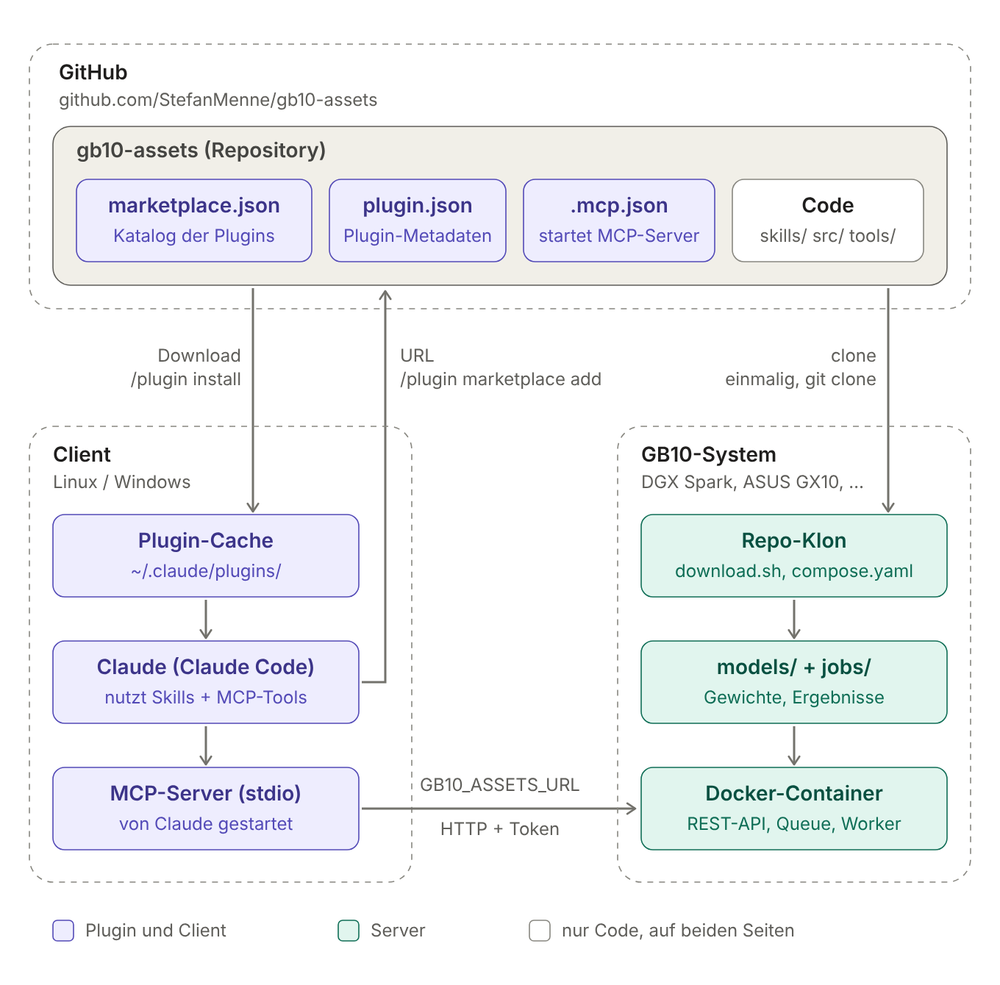

# gb10-assets

> **Work in progress:** this repo is still under construction and not usable yet.

Self-hosted generative asset pipeline (image, 3D, video, speech, music) for NVIDIA DGX Spark, ASUS Ascent GX10
and other GB10 systems.

## Description

A GB10 system generates images, videos, 3D assets for games and more, triggered remotely from a client machine.

1. **Server (GB10):** clone this repo, pull or build the Docker image, start the container.
2. **Server (GB10):** download the weights of the models you want to use with the included scripts.
3. **Client (your workstation):** install the client, submit jobs and receive the generated assets.

Clients talk to the server via REST API, MCP or the Claude Code plugin (skills). The models are chosen mainly
for their free licenses.



## Models

| Tool | Model | Task | License | Weights | Client |
|---|---|---|---|---|---|
| `flux2-klein` | [FLUX.2 \[klein\] 4B](https://huggingface.co/black-forest-labs/FLUX.2-klein-4B) | text to image, optional reference images | Apache-2.0 | ~16 GB | `gb10-assets image` |
| `qwen-image-edit` | [Qwen-Image-Edit-2511](https://huggingface.co/Qwen/Qwen-Image-Edit-2511) with the 4-step [Lightning LoRA](https://huggingface.co/lightx2v/Qwen-Image-Edit-2511-Lightning) | edit 1-3 images with an instruction | Apache-2.0 | ~59 GB | `gb10-assets edit` |
| `qwen-tts` | [Qwen3-TTS 1.7B VoiceDesign](https://huggingface.co/Qwen/Qwen3-TTS-12Hz-1.7B-VoiceDesign) and [Base](https://huggingface.co/Qwen/Qwen3-TTS-12Hz-1.7B-Base) | speech with a voice designed from a description or cloned from a recording; de, en, es, fr, it, ja, ko, pt, ru, zh | Apache-2.0 | ~9 GB | `gb10-assets voice`, `speak` |
| `confucius-tts` | [Confucius4-TTS](https://huggingface.co/netease-youdao/Confucius4-TTS) | cross-lingual voice cloning (e.g. a German voice speaking Thai); 14 languages incl. th, vi, id, ms | Apache-2.0 | ~6 GB | `gb10-assets speak-multilingual` |
| `ltx-video` | [LTX-2.5](https://huggingface.co/Lightricks/LTX-2.5) 22B distilled, NVFP4 | video with sound from text or keyframe images, video for an audio track, retake of a time range | [LTX-2.x Community](https://github.com/Lightricks/LTX-2/blob/main/LICENSE-2_x)¹ | ~50 GB | `gb10-assets video`, `audio-to-video`, `retake` |

¹ Not an open-source license: free, also commercially, for companies under $10M annual revenue; the model is
gated, so downloading it needs `HF_TOKEN` and the license accepted on its Hugging Face page.

The server keeps one model in memory at a time and switches when a job for another tool arrives.

## Server installation (GB10)

### Prerequisites

Docker with the Compose plugin and the NVIDIA Container Toolkit (both preinstalled on DGX OS). The image is
built for `linux/arm64` with CUDA 13 and contains the server and the Python environment of every tool. Model
weights are not part of the image; they live in a host directory that is mounted into the container.

### Steps

```sh
# 1. clone the repo
git clone https://github.com/StefanMenne/gb10-assets.git && cd gb10-assets

# 2. create the configuration .env (with a random token) and the models/ and jobs/ directories
scripts/docker.sh init                  # or without authentication: scripts/docker.sh init_without_token

# 3. get the image: pull it from Docker Hub ...
scripts/docker.sh pull
#    ... or build it yourself (about 10 minutes the first time)
scripts/docker.sh build

# 4. start the server (port 8750, restarts automatically after a reboot)
scripts/docker.sh up

# 5. download the first model (FLUX.2 [klein], about 16 GB); without a name all models (about 140 GB,
#    ltx-video needs HF_TOKEN in .env, see Model weights)
scripts/docker.sh download flux2-klein
```

Then check from any machine in the network:

```sh
curl http://<gb10-host>:8750/health
# {"status":"ok","api_version":1,"version":"0.1.0","running":null,"queued":0,"worker":null}
```

## Client installation

The client needs two values from the server:

| Variable | Example | Where from |
|---|---|---|
| `GB10_ASSETS_URL` | `http://192.168.178.20:8750` | address of the GB10 system and `GB10_ASSETS_PORT` |
| `GB10_ASSETS_TOKEN` | `34fa…` (64 characters) | `GB10_ASSETS_TOKEN` in the server's `.env`; not needed with `init_without_token` |

Install the client with [uv](https://docs.astral.sh/uv/) (`curl -LsSf https://astral.sh/uv/install.sh | sh`),
no clone needed:

```sh
uv tool install "gb10-assets[client] @ git+https://github.com/StefanMenne/gb10-assets"
```

Store URL and token once, so every new terminal has them (see [Token](#token)):

```sh
mkdir -p ~/.config/gb10-assets
TOKEN=$(ssh <user>@<gb10-host> "grep ^GB10_ASSETS_TOKEN= ~/gb10-assets/.env | cut -d= -f2")
cat > ~/.config/gb10-assets/env <<EOF
export GB10_ASSETS_URL=http://<gb10-host>:8750
export GB10_ASSETS_TOKEN=$TOKEN
EOF
chmod 600 ~/.config/gb10-assets/env
echo '[ -f ~/.config/gb10-assets/env ] && . ~/.config/gb10-assets/env' >> ~/.bashrc
. ~/.config/gb10-assets/env
```

Create the first image:

```sh
gb10-assets image "a red fox in a snowy forest, golden hour" -o ~/gb10-images
```

The command waits for the result and prints the paths of the PNG files. The first job takes longer because the
model is loaded first. More options:

```sh
gb10-assets image "isometric pixel art castle" -n 4 --seed 42 -W 1024 -H 768 -o ~/gb10-images   # 4 variants
gb10-assets image "the same character, waving" -i ref.png -o ~/gb10-images                     # reference image
gb10-assets edit "replace the background with a beach at sunset" -i photo.png -o ~/gb10-images   # edit an image
gb10-assets edit "the cat from image 1 sits on the sofa from image 2" -i cat.png -i sofa.png -o ~/gb10-images
gb10-assets voice "warm female voice, about 40, calm, slow pace" "Hallo, schön dass du da bist." -l de -o ~/gb10-voices
gb10-assets speak "Willkommen im Spiel!" "Bis bald." -r voice.wav -T voice.txt -l de -o ~/gb10-voices  # cloned voice
gb10-assets speak-multilingual "สวัสดีครับ ยินดีต้อนรับ" -r voice.wav -l th -o ~/gb10-voices      # German voice, Thai text
gb10-assets video "a red fox trots through deep snow, the camera follows it, wind howls" -o ~/gb10-videos
gb10-assets video "the knight turns and walks away" -i knight.png -d 6 -o ~/gb10-videos         # image to video
gb10-assets video "the flower blooms" -i bud.png -i bloom.png -d 4 -o ~/gb10-videos              # first + last frame
gb10-assets audio-to-video "a woman sings into a microphone on stage" -a song.wav -i singer.png -o ~/gb10-videos
gb10-assets retake clip.mp4 "the fox jumps over a log" --start 2 --end 4 -o ~/gb10-videos       # edit a segment
gb10-assets health                                                                             # server state
gb10-assets log <job-id>                                                                       # log of a failed job
```

Without installing anything, plain `curl` works too:

```sh
H="Authorization: Bearer $GB10_ASSETS_TOKEN"
curl -s -H "$H" "$GB10_ASSETS_URL/jobs" \
  -F 'request={"tool":"flux2-klein","params":{"prompt":"a red fox in a snowy forest","count":2}}'   # returns "id"
curl -s -H "$H" "$GB10_ASSETS_URL/jobs/<id>"                                    # "state", "outputs" when done
curl -s -H "$H" -o fox.png "$GB10_ASSETS_URL/jobs/<id>/files/<output-name>.png"
```

## Token

The server is reachable from every device in the network. The token is its password: every request except
`/health` has to send it as `Authorization: Bearer <token>`, otherwise the server answers `401`. Without it,
any device in the network could use the GPU, download your results or delete jobs.

The token lives in the `.env` file in the repo directory on the GB10 system (`~/gb10-assets/.env`), not in the
container and not in the image. `scripts/docker.sh init` generates it; if `.env` already exists, it asks before
overwriting it and keeps the old file as `.env.bak`. `build`, `up` and restarts never change it. Docker Compose
passes it to the container as an environment variable on every start. Each client needs a copy of it (see [Client
installation](#client-installation)).

**New token** (for example if it leaked); then update the clients:

```sh
sed -i "s/^GB10_ASSETS_TOKEN=.*/GB10_ASSETS_TOKEN=$(openssl rand -hex 32)/" .env
scripts/docker.sh up
```

**Without authentication:** `GB10_ASSETS_TOKEN=none` in `.env` (what `scripts/docker.sh init_without_token` writes
after a security confirmation) turns the check off: the server accepts every request, with or without a token, and
logs a warning at startup. Clients then need only `GB10_ASSETS_URL`. Use this only in a trusted network and never
forward the port to the internet.

## Configuration (`.env`)

`scripts/docker.sh init` copies [`.env.example`](.env.example) to `.env`. `.env` is not committed because it holds
the token. Docker Compose reads it automatically; after editing, run `scripts/docker.sh up` to apply the changes.

| Variable | Default | Meaning |
|---|---|---|
| `GB10_ASSETS_TOKEN` | generated by `init` | bearer token for all API calls, at least 16 characters; `none` disables authentication |
| `MODELS_DIR` | `./models` | host directory with the model weights, mounted at `/models` |
| `JOBS_DIR` | `./jobs` | host directory for job inputs and results, mounted at `/jobs` |
| `GB10_ASSETS_PORT` | `8750` | host port of the server |
| `GB10_ASSETS_IMAGE`, `GB10_ASSETS_TAG` | `stefanmenne/gb10-assets`, `latest` | image name for build, push and pull |
| `GB10_UID`, `GB10_GID` | your user (`init`) | the container runs as this user, so the files in `MODELS_DIR` and `JOBS_DIR` belong to you |
| `HF_TOKEN` | empty | Hugging Face token, only needed for gated models |
| `WORKER_IDLE_S`, `MEMORY_WAIT_S`, `WORKER_READY_S`, `JOB_TTL_H` | see `.env.example` | queue tuning |

**Models in another directory**, for example on a second disk: set `MODELS_DIR=/data/gb10-models` in `.env`.
Absolute paths, `~/...` and paths relative to the repo directory work. Compose mounts that directory, and
`scripts/download-all.sh` downloads into it as well. A variable set in the shell overrides `.env`.

## Commands

| `scripts/docker.sh ...` | Does |
|---|---|
| `init` | create `.env` with a random token and the `MODELS_DIR`/`JOBS_DIR` directories; asks before overwriting an existing `.env` (backup: `.env.bak`) |
| `init_without_token` | the same with `GB10_ASSETS_TOKEN=none` (no authentication), after a security confirmation |
| `build` | build the image, tagged `:latest` and `:<version>` from `pyproject.toml` |
| `pull` | download the published image instead of building it |
| `push` | upload both tags to the registry |
| `download [tool ...]` | download model weights with the image, no uv needed on the host |
| `up` / `down` / `logs` | start in the background, stop, follow the log |

The script wraps plain Docker Compose: `docker compose build`, `docker compose up -d`, `docker compose pull` and
so on work too.

## Publishing on Docker Hub

```sh
docker login                       # Docker Hub account
# in .env: GB10_ASSETS_IMAGE=<dockerhub-user>/gb10-assets
scripts/docker.sh build
scripts/docker.sh push             # pushes :latest and :<version>
```

Other GB10 systems then use the image without building it: clone the repo (for `compose.yaml` and the scripts),
run `scripts/docker.sh init`, set the same `GB10_ASSETS_IMAGE`, then `scripts/docker.sh pull` and
`scripts/docker.sh up`. `GB10_ASSETS_TAG=0.1.0` pins a version.

## Updating

```sh
git pull && scripts/docker.sh build && scripts/docker.sh up    # or: scripts/docker.sh pull && scripts/docker.sh up
uv tool upgrade gb10-assets                                    # on the client
```

Client and server check that they speak the same API version; update both to the same release.

## Model weights

```sh
scripts/docker.sh download              # all tools inside the container, or name them: ... download flux2-klein
scripts/download-all.sh                 # the same directly on the host (needs uv)
```

Weights go to `MODELS_DIR`: the environment variable, else `MODELS_DIR` in `.env`, else `<repo>/models`.
Gated models need `HF_TOKEN`: accept the license on the model page (currently only
[LTX-2.5](https://huggingface.co/Lightricks/LTX-2.5)), create a read token at
<https://huggingface.co/settings/tokens> and set `HF_TOKEN=...` in `.env`.

## Development

```sh
uv run --frozen --group dev pytest
```

Without Docker, the server runs from the repo: `uv sync` in each `tools/<tool>/` (for `ltx-video` followed by
`tools/ltx-video/build_kernels.sh`, which compiles the NVFP4 kernels and needs the CUDA toolkit), then
`GB10_ASSETS_TOKEN=... uv run --extra server gb10-assets server`. It reads its settings from environment
variables only (not from `.env`); see `src/gb10_assets/server/config.py`.
